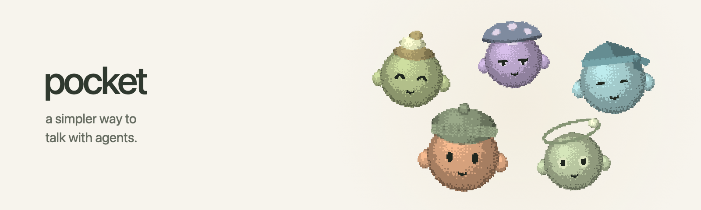
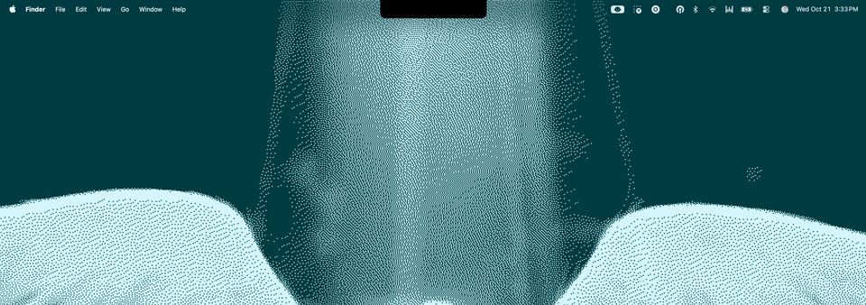
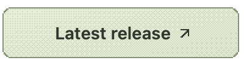

<picture>
  <source media="(prefers-color-scheme: dark)" srcset="docs/images/banner-dark.png">
  <source media="(prefers-color-scheme: light)" srcset="docs/images/banner-light.png">
  
</picture>

# `pocket`

[](https://github.com/owenps/pocket/actions/workflows/ci.yml)

A small, notch-centered macOS interface to communicate with agents. Open it from anywhere with <kbd>⌃</kbd> <kbd>Space</kbd> by default.

> [!IMPORTANT]
> **Agent integration does not work yet.** Pocket is still a local prototype with simulated replies. No agent is connected, and the app makes no network requests. Star ⭐︎ the project for updates!



## Basic Controls

<table>
  <tr><td><kbd>⌃</kbd> <kbd>Space</kbd></td><td>Opens / collapses pocket (configurable in Settings)</td></tr>
  <tr><td><kbd>Return</kbd></td><td>Sends</td></tr>
  <tr><td><kbd>⇧</kbd> <kbd>Return</kbd></td><td>Adds a line</td></tr>
  <tr><td><kbd>Esc</kbd></td><td>Collapses pocket</td></tr>
  <tr><td><kbd>Tab</kbd></td><td>Swaps focus between prompt box and conversation</td></tr>
</table>

## Download (Coming Soon)

<a href="../../releases/latest">
  <picture>
    <source media="(prefers-color-scheme: dark)" srcset="docs/images/releases-dark.png">
    <source media="(prefers-color-scheme: light)" srcset="docs/images/releases-light.png">
    
  </picture>
</a>

## Local Development

Requires **macOS 14+**, **Swift 6+**, and **Xcode Command Line Tools or Xcode**. No third-party dependencies.

From the project directory:

```sh
./scripts/build-app.sh
open dist/Pocket.app
```

Local builds are ad-hoc signed, not notarized for distribution.

## Feedback

Outside contributions and pull requests are closed for now. Bug reports and feature requests are welcome.

<a href="../../issues/new">
  <picture>
    <source media="(prefers-color-scheme: dark)" srcset="docs/images/issues-dark.png">
    <source media="(prefers-color-scheme: light)" srcset="docs/images/issues-light.png">
    
  </picture>
</a>

## Privacy

The prototype sends nothing over the network. Preferences are stored locally in macOS UserDefaults, without Pocket-managed encryption. Simulated conversations stay in memory and aren't saved across restarts. macOS manages launch-at-login registration.

For tests, architecture, and manual checks, see [Development](docs/development.md).

## License

[MIT](LICENSE).
